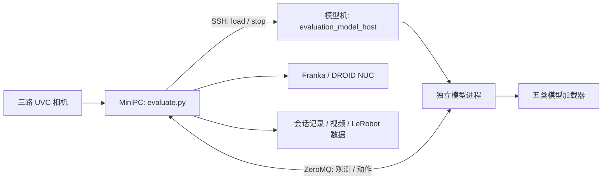

# VLA Eval CLI

面向 **Franka/DROID + 三路相机**的命令行 VLA 评测工具。从独立评测系统提取，包含模型接入、交互评测、人工评分、会话恢复、视频记录和 LeRobot v3 导出。

支持 **G05、PI05、LingBot、MolmoAct2、GR00T**。任务标识、语言指令、权重及机器信息由使用者配置。没有内置任务清单，也不按任务名自动选择模型或调整时长。

此版本提供源码与配置模板；权重、相机标定、NUC 控制服务和各模型上游依赖需自行准备。发布前验证覆盖离线逻辑、模拟执行与真实 FFmpeg/Parquet 导出，未对这个整理后的版本进行 GPU 加载或真机验收。

## 架构



两台机器放置同一版本的本仓库和同一份模型配置。MiniPC 运行交互入口；模型机由 SSH 管理器启动所选模型自己的 Python 环境。`load` 仅加载模型；明确输入 `start` 才连接机器人与相机。

## 快速开始

### 1. 安装评测端依赖

实机运行要求 Linux x86_64，Python 3.10 或更高版本；模型环境版本另见[模型安装说明](docs/models.md)。已配置好的 DROID NUC 应能提供端口 4242 的 RPC 服务。本仓库包含 MiniPC 侧 DROID/UVC 代码，不安装 NUC 的实时内核、libfranka 或控制服务。

```bash
git clone https://github.com/mayatutu/vla-eval-cli.git
cd vla-eval-cli
python3 -m venv .venv-client
source .venv-client/bin/activate
python -m pip install -r requirements/client.txt
```

系统还需 `ssh`、`ss`、`fuser`、`ffmpeg`、`ffprobe`。Ubuntu 可安装：

```bash
sudo apt-get install openssh-client iproute2 psmisc ffmpeg
```

首次通过终端登录模型机并核对其 SSH 主机指纹；程序使用 `StrictHostKeyChecking=yes`，不会自行接受未知主机。密码由 SSH 终端读取，不写入配置。

### 2. 填写配置

```bash
cp config/models.example.json config/models.local.json
cp config/cameras.example.yaml config/cameras.local.yaml
```

编辑配置中的 `<...>` 占位值。相机文件按[配置说明](docs/configuration.md)填写实际 USB 路径、相机标识和标定文件。`*.local.*` 默认不提交 Git。

模型配置按 `defaults → backends[backend] → models[model_id]` 合并，后一层覆盖前一层；字典字段整体替换。共享字段只填一遍。`models` 中的 ID 可任意命名，保留需要运行的模型即可。

| 必填项 | 填写内容 |
|---|---|
| `instruction` | 当前任务的完整指令，必要时在模型条目中覆盖 |
| `checkpoint`、`revision` | 模型机上的完整权重目录、你自己的权重版本标识 |
| `python` | 对应模型环境 Python 的绝对路径 |
| `bind` | 两端都可访问的 `tcp://模型机IP:端口` |
| `nuc_ip` | 提供 DROID RPC 的 NUC 地址 |
| `camera_config` | MiniPC 上相机 YAML 的绝对路径 |
| `cameras` | 模型要求的两路或三路图像角色对应的相机 ID |
| `recording_cameras` | 三路记录相机 ID；和模型输入中的同名角色保持一致 |
| 各模型附属资产 | tokenizer、归一化、处理器等，见[模型说明](docs/models.md) |

`action_steps` 是每次推理动作块长度；`--steps` 是单次评测总动作步数上限；`max_action_seconds` 从首条模型动作开始计时，三者含义不同。模板中的频率/时长是参考默认值，需要与自己的训练及评测条件核对。

把填好的同一份 `models.local.json` 放到两端。模型路径在模型机上有效，相机路径在 MiniPC 上有效；另一端不需要建立对应的空目录。两端配置必须保持一致，程序会核对完整 profile 的哈希。

### 3. 只检查配置与执行计划

以下命令不会连接模型、机器人或相机：

```bash
python tools/check_config.py --catalog config/models.local.json --models pi05
python evaluate.py --catalog config/models.local.json \
  --task '<YOUR_TASK_ID>' --models pi05 --repeats 25 --steps 800 --plan
```

`--plan` 也可读取未填写的示例，帮助查看结构；它不代表环境和权重已验证。`check_config.py` 会拒绝所选模型中的未填占位值。

在模型机检查权重小文件、格式和分片完整性：

```bash
python model.py inspect --catalog config/models.local.json --model pi05
```

此命令不加载 GPU 权重，也不证明推理正确。权重下载及格式要求见[模型说明](docs/models.md)。

### 4. 开始交互评测

以下为实机入口。把所有占位符换成实际值，确认机器人作业区域可用，并退出其他占用机器人、相机或模型服务的 client。

```bash
python evaluate.py --catalog config/models.local.json \
  --task '<YOUR_TASK_ID>' --models pi05 groot \
  --repeats 25 --steps 800 --session runs/session-001 \
  --ai-host '<USER>@<MODEL_HOST>' \
  --ai-root '/absolute/path/to/vla-eval-cli' \
  --ai-catalog '/absolute/path/to/vla-eval-cli/config/models.local.json' \
  --run
```

`--models` 按输入顺序执行，可选择一款、多款或五款。模型加载结束后仍需手动开始每次评测。

| 交互命令 | 行为 |
|---|---|
| `status` | 查看当前模型、目标次数及导出状态 |
| `load` | 加载当前模型，完成后等待 `start` |
| `start` | 开始一次机器人/相机评测 |
| `finish` | 正常提前结束，随后人工评分 |
| `pause` | 中断，保留记录，不计次 |
| `score 80 success 备注` | 人工标记成功、评分并导出 |
| `score 20 failed 备注` | 人工标记失败、评分并导出 |
| `next` | 当前模型完成目标次数后加载下一款 |
| `repeats 25 [模型ID]` | 修改当前/后续目标次数 |
| `steps 800` | 修改下一次动作步数上限 |
| `retry-export <试验ID>` | 仅重试导出，不运行机器人 |
| `quit` | 空闲时退出；停止本会话创建的模型服务 |

成功与分数分别填写，0 分也能作为完整失败试验保存。**只有完整、已评分且成功导出的试验才计次**。到达时间上限仍需人工判定成功/失败。

运行中 `Ctrl+C` 请求中断，等待当前调用返回并收尾；终端 EOF 也走清理路径。这不是硬件急停，设备失联或进程被强杀时不能保证软件完成收尾。

### 5. 复位行为

本版保留这套独立评测的实际行为：`start` 创建 `DroidRobot` 时，DROID 默认执行一次复位，先打开夹爪，再移动到既有 reset joints；模型动作随后开始。结束、暂停或报错时关闭连接和记录资源，**没有新增结束复位**。这是独立评测 CLI 的行为，不能与另一套原始 client 的复位改动混为一谈。换机前需核对固定复位姿态是否适用于自己的安装。

### 6. 恢复与导出

```bash
python evaluate.py --catalog config/models.local.json --resume runs/session-001 \
  --ai-host '<USER>@<MODEL_HOST>' \
  --ai-root '/absolute/path/to/vla-eval-cli' \
  --ai-catalog '/absolute/path/to/vla-eval-cli/config/models.local.json' --run
```

恢复沿用原模型顺序、目标和已完成记录。模型配置变化时拒绝继续旧会话。异常退出时尚未结束的试验标记为 interrupted，不冒充完成。

结果位于：

```text
runs/session-001/
  session.json              # 顺序、次数、评分、状态
  profiles.json             # 本会话配置快照
  attempts/<attempt-id>/
    actions.jsonl           # 动作发送记录
    trial-result.json       # 结束原因、实际步数
    recording/
      state/                # 独立状态 RPC 采样
      continuous/           # 三路相机时间戳与采样记录
      lerobot/              # 单次试验的 LeRobot v3 数据
```

每次导出包含 Parquet、三路视频和元数据；不自动上传数据。保留现场版本的 30 Hz 导出策略：按时间网格选取最近的真实采样，允许复用同一来源，并保存复用标记、原始时间戳、RPC 延迟和对齐诊断。`30 Hz` 是输出网格，不等于每秒获得 30 个独立机器人测量；训练前可根据诊断筛选。

成功导出并校验后，原始 PNG 按现有清理逻辑移除，视频、数值记录和来源哈希保留；失败时保留源文件供重试。数据含义与排错见[运行说明](docs/operations.md)。

## 离线测试

```bash
python -m pip install -r requirements/test.txt
python -m pytest -q
```

测试使用模拟机器人/模型，不启动实机。导出测试需要本机 `ffmpeg` 和 `ffprobe`。详见[验证范围](docs/validation.md)。

## 目录

| 路径 | 内容 |
|---|---|
| `evaluate.py` / `model.py` | 评测入口 / 模型检查与启动入口 |
| `runtime/evaluation_*.py` | 会话、执行、记录、模型生命周期、导出 |
| `runtime/*checkpoint_backend.py` | 五类模型及不同权重格式的加载器 |
| `runtime/droid/` | MiniPC DROID/UVC 运行代码 |
| `runtime/colosseum_client/` | 机器人适配器、动作校验和记录组件 |
| `runtime/franka_vla_control/` | 动作运行与消息封装 |
| `config/` | 通用配置、权重格式变体与架构参数 |
| `tools/` | 无设备配置检查、资产哈希及 G05 overlay 准备 |
| `requirements/` | 依赖及已观察的版本参考 |
| `patches/` / `third_party/` | 必要上游补丁及来源声明 |

源码整理不会自动部署到现有机器。第三方组件仍遵循各自条款；本仓库未给全部代码重新授予统一许可证，详见 [THIRD_PARTY_NOTICES.md](THIRD_PARTY_NOTICES.md)。
